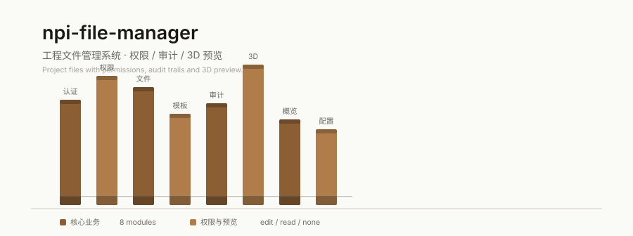
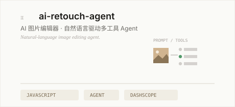

<picture>
  <source media="(prefers-color-scheme: dark)" srcset="./assets/hero-dark.svg">
  <source media="(prefers-color-scheme: light)" srcset="./assets/hero-light.svg">
  
</picture>

[展览说明 Note](#展览说明--note-on-the-collection) · [展品 Works](#展品--works) · [工具 Toolbox](#工具--toolbox) · [通道 Elsewhere](#通道--elsewhere)

## 展览说明 · Note on the Collection

这里挂着几件小玩意。有替人管工程的，有替人改 PDF 的，也有一件，只为了让一句话变成一次编辑。它们出自同一种脾气：先弄清问题为什么反复出现，再决定是写一条规矩，还是做一件能长期用的东西。多数工具从具体的麻烦里长出来——权限分不清、PDF 改不动、流程要点五次——做完就一直用下去。

*There are a few small things hanging here. One organises engineering files, one edits PDFs, and one turns a sentence into an edit. They share the same temperament: understand why a problem keeps returning before deciding whether it deserves a rule or a tool. Most grew from real friction — unclear permissions, stubborn PDFs, workflows that cost five extra clicks — and once built, they stay in use.*

## 展品 · Works

  <a href="https://github.com/justin-yu-space/npi-file-manager">
    <picture>
      <source media="(prefers-color-scheme: dark)" srcset="./assets/works/npi-file-manager-dark.svg">
      <source media="(prefers-color-scheme: light)" srcset="./assets/works/npi-file-manager-light.svg">
      
    </picture>
  </a>

<b>Ⅰ · npi-file-manager</b> 
工程文件管理系统：多级目录、细粒度权限、审计日志与 3D 预览。 
<i>Project files with multi-level folders, granular permissions, audit trails and 3D preview.</i>

  <a href="https://github.com/justin-yu-space/pdf-toolbox">
    <picture>
      <source media="(prefers-color-scheme: dark)" srcset="./assets/works/pdf-toolbox-dark.svg">
      <source media="(prefers-color-scheme: light)" srcset="./assets/works/pdf-toolbox-light.svg">
      
    </picture>
  </a>

<b>Ⅱ · pdf-toolbox</b> 
PDF 编辑工具箱：文字替换、插入对齐、样式检测，桌面端交付。 
<i>A desktop PDF toolbox for text replacement, alignment and style inspection.</i>

  <a href="https://github.com/justin-yu-space/ai-retouch-agent">
    <picture>
      <source media="(prefers-color-scheme: dark)" srcset="./assets/works/ai-retouch-agent-dark.svg">
      <source media="(prefers-color-scheme: light)" srcset="./assets/works/ai-retouch-agent-light.svg">
      
    </picture>
  </a>

<b>Ⅲ · ai-retouch-agent</b> 
AI 图片编辑器：自然语言指令 + 多工具调用的编辑 Agent。 
<i>An image editing agent driven by natural language and multiple tools.</i>

## 工具 · Toolbox

后端与数据 / BACKEND &amp; DATA

<kbd>Python</kbd>&nbsp; <kbd>Flask</kbd>&nbsp; <kbd>Java</kbd>&nbsp; <kbd>Spring Boot</kbd>&nbsp; <kbd>MyBatis-Plus</kbd>&nbsp; <kbd>SQLite</kbd>&nbsp; <kbd>MySQL</kbd>&nbsp; <kbd>Redis</kbd>&nbsp; <kbd>MinIO</kbd>

前端与桌面 / FRONTEND &amp; DESKTOP

<kbd>Vue 3</kbd>&nbsp; <kbd>Element UI</kbd>&nbsp; <kbd>three.js</kbd>&nbsp; <kbd>原生 JS</kbd>&nbsp; <kbd>PyInstaller</kbd>&nbsp; <kbd>waitress</kbd>

工程与领域 / ENGINEERING &amp; DOMAIN

<kbd>Git</kbd>&nbsp; <kbd>Playwright</kbd>&nbsp; <kbd>OCCT</kbd>&nbsp; <kbd>pythonocc</kbd>&nbsp; <kbd>Excel COM</kbd>&nbsp; <kbd>WPS</kbd>

## 通道 · Elsewhere

  &nbsp;
  &nbsp;
  &nbsp;
  

 

把反复出现的问题，做成可复用的东西。 
<i>Turning recurring problems into reusable things.</i>

