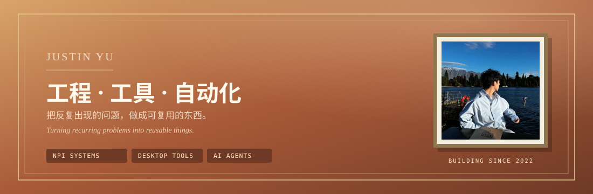
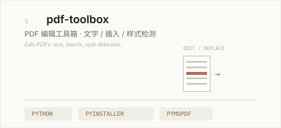

<picture>
  <source media="(prefers-color-scheme: dark)" srcset="./assets/hero-dark.svg">
  <source media="(prefers-color-scheme: light)" srcset="./assets/hero-light.svg">
  
</picture>

[简介 About](#简介--about) · [作品 Works](#作品--works) · [工具 Toolbox](#工具--toolbox) · [通道 Elsewhere](#通道--elsewhere)

## 简介 · About

我做工程文件管理系统、企业内网工具链与自动化。偏好的做法：先弄清问题为什么反复出现，再决定是写一条规矩，还是做一件能长期用的东西。多数工具从具体的麻烦里长出来——权限分不清、PDF 改不动、流程要点五次——做完就一直用下去。

*I build engineering file systems, internal toolchains, and automation. My rule: understand why a problem keeps returning before deciding whether it deserves a rule or a tool. Most of these grew from real friction — unclear permissions, stubborn PDFs, workflows that cost five extra clicks.*

## 作品 · Works

<table>
<tr>
<td width="50%" valign="top" align="center">

<picture>
  <source media="(prefers-color-scheme: dark)" srcset="./assets/works/npi-file-manager-dark.svg">
  <source media="(prefers-color-scheme: light)" srcset="./assets/works/npi-file-manager-light.svg">
  
</picture>

<a href="https://github.com/justin-yu-space/npi-file-manager"><b>Ⅰ · npi-file-manager</b></a> 
工程文件管理系统：多级目录、细粒度权限、审计日志、3D 预览。

</td>
<td width="50%" valign="top" align="center">

<picture>
  <source media="(prefers-color-scheme: dark)" srcset="./assets/works/pdf-toolbox-dark.svg">
  <source media="(prefers-color-scheme: light)" srcset="./assets/works/pdf-toolbox-light.svg">
  
</picture>

<a href="https://github.com/justin-yu-space/pdf-toolbox"><b>Ⅱ · pdf-toolbox</b></a> 
PDF 编辑工具箱：文字替换、插入对齐、样式检测，桌面端交付。

</td>
</tr>
<tr>
<td width="50%" valign="top" align="center">

<picture>
  <source media="(prefers-color-scheme: dark)" srcset="./assets/works/ai-retouch-agent-dark.svg">
  <source media="(prefers-color-scheme: light)" srcset="./assets/works/ai-retouch-agent-light.svg">
  
</picture>

<a href="https://github.com/justin-yu-space/ai-retouch-agent"><b>Ⅲ · ai-retouch-agent</b></a> 
AI 图片编辑器：自然语言指令 + 多工具调用的编辑 Agent。

</td>
<td width="50%" valign="top" align="center">

在做的方向 / CURRENT FOCUS

<kbd>NPI v5.0</kbd>&nbsp; <kbd>3D Preview</kbd>&nbsp; <kbd>OCCT / GLB</kbd> 
<kbd>RBAC 权限</kbd>&nbsp; <kbd>Waitress</kbd> 
<kbd>PyInstaller</kbd>&nbsp; <kbd>Excel COM</kbd>

工程文件、权限精确、桌面交付、视觉细节。 
<i>Files, precise permissions, desktop delivery, visual craft.</i>

</td>
</tr>
</table>

## 工具 · Toolbox

后端与数据 / BACKEND &amp; DATA

<kbd>Python</kbd>&nbsp; <kbd>Flask</kbd>&nbsp; <kbd>Java</kbd>&nbsp; <kbd>Spring Boot</kbd>&nbsp; <kbd>MyBatis-Plus</kbd>&nbsp; <kbd>SQLite</kbd>&nbsp; <kbd>MySQL</kbd>&nbsp; <kbd>Redis</kbd>&nbsp; <kbd>MinIO</kbd>

前端与桌面 / FRONTEND &amp; DESKTOP

<kbd>Vue 3</kbd>&nbsp; <kbd>Element UI</kbd>&nbsp; <kbd>three.js</kbd>&nbsp; <kbd>原生 JS</kbd>&nbsp; <kbd>PyInstaller</kbd>&nbsp; <kbd>waitress</kbd>

工程与领域 / ENGINEERING &amp; DOMAIN

<kbd>Git</kbd>&nbsp; <kbd>Playwright</kbd>&nbsp; <kbd>OCCT</kbd>&nbsp; <kbd>pythonocc</kbd>&nbsp; <kbd>Excel COM</kbd>&nbsp; <kbd>WPS</kbd>

## 通道 · Elsewhere

  &nbsp;
  &nbsp;
  

 

把反复出现的问题，做成可复用的东西。 
<i>Turning recurring problems into reusable things.</i>

